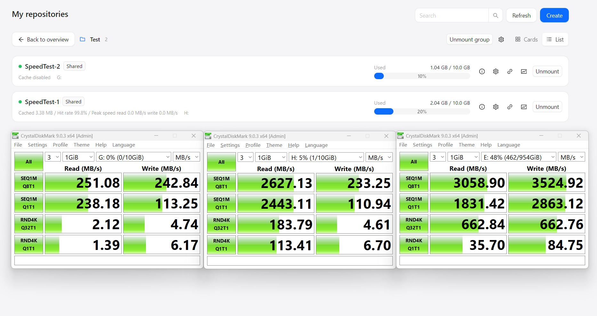
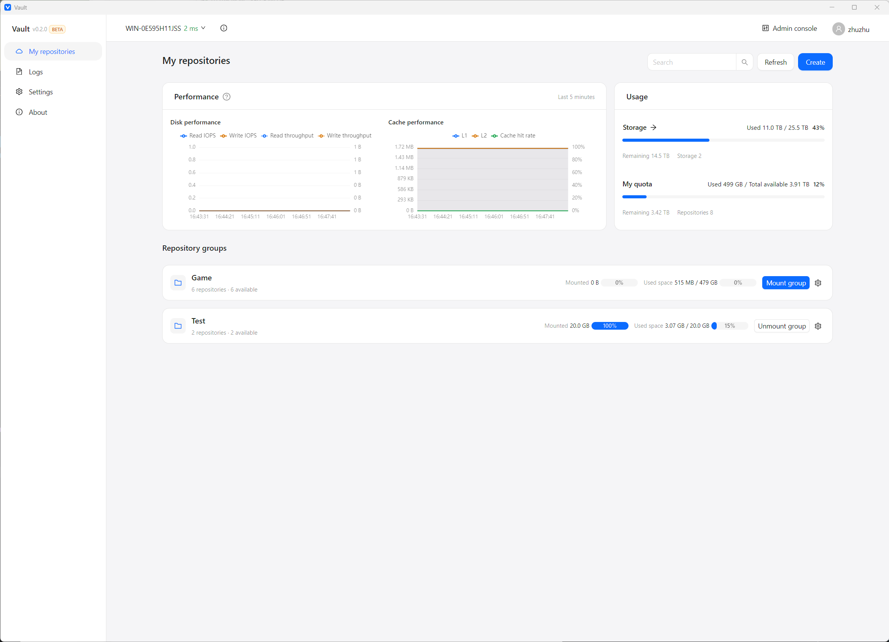
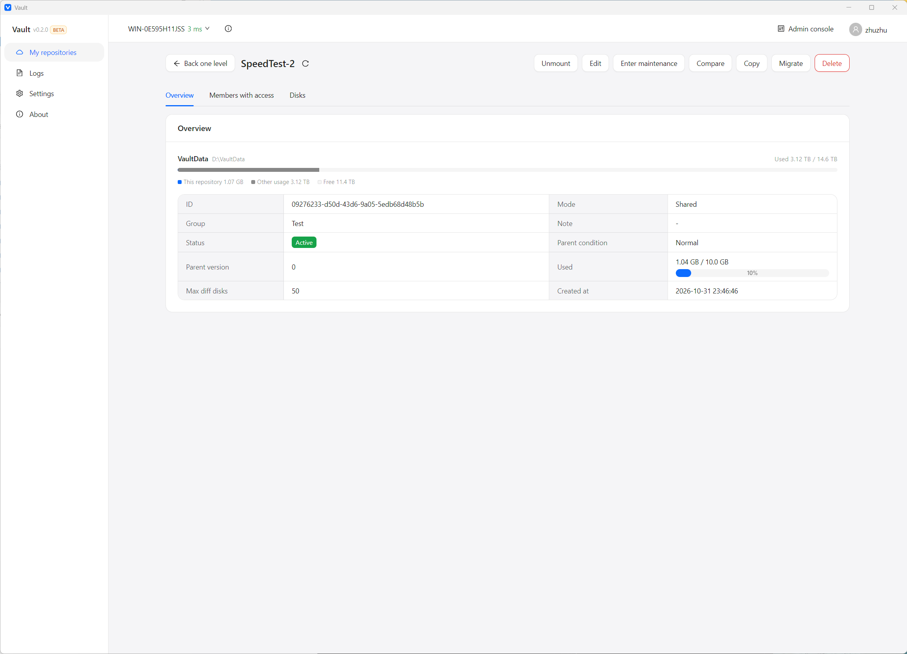
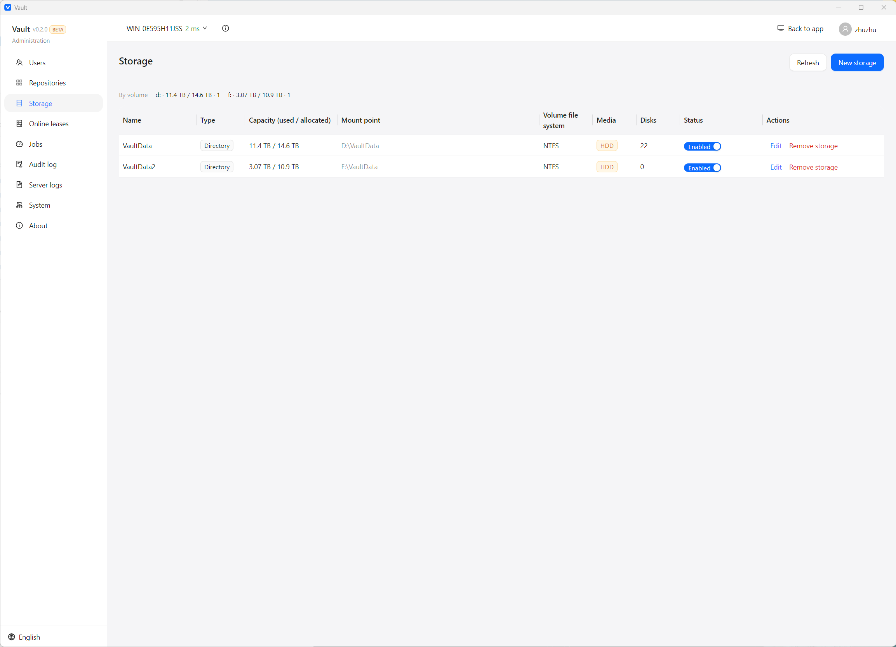

<div align="center">

**English** | [简体中文](README.zh-CN.md)

# Vault

**One install, many users. Accelerate iSCSI with local SSD for read-heavy workloads.**

A self-hosted virtual disk and iSCSI storage platform: shared parent disks with per-user differencing disks, one-click client mounting, and a bypass read cache.

[](https://go.dev)


[Performance](#performance) · [Benchmark](#benchmark) · [Quick start](#quick-start) · [Core features](#core-features) · [iSCSI bypass acceleration](#iscsi-bypass-acceleration) · [Architecture](#architecture) · [Documentation](#documentation)

</div>

Vault brings virtual disks, iSCSI targets, user authorization, leases, quotas, and client mounting into one application. In shared mode there is only one parent disk, while each user gets an independent differencing disk. The client adds a transparent iSCSI read cache locally, keeping hot data from the remote HDD in memory and on SSD.

It fits scenarios like:

- The same software or game must be installed on many machines, and you do not want to copy a full disk to every one.
- You want to manage disks, iSCSI, accounts, and mounts in one place instead of juggling VHDX files, Windows iSCSI Target, CHAP, and client scripts separately.
- The server only has HDDs, iSCSI random reads are slow and network-sensitive, and you want hot data to read like a local disk.

## Performance

CrystalDiskMark 9.0.3 on 10 GiB Vault test repositories, left to right: **no cache** (direct iSCSI), **cache enabled**, and a **local SSD volume (the cache disk)** for reference. Test size 1 GiB, 3 passes, MB/s.



| Test | No cache | With cache | Local SSD (cache disk) |
| --- | ---: | ---: | ---: |
| SEQ1M Q8T1 read | 251.08 | **2627.13** | 3058.90 |
| SEQ1M Q1T1 read | 238.18 | **2443.11** | 1831.42 |
| RND4K Q32T1 read | 2.12 | **183.79** | 662.84 |
| RND4K Q1T1 read | 1.39 | **113.41** | 35.70 |
| SEQ1M Q8T1 write | 242.84 | 233.25 | 3524.92 |
| SEQ1M Q1T1 write | 113.25 | 110.94 | 2863.12 |
| RND4K Q32T1 write | 4.74 | 4.61 | 662.76 |
| RND4K Q1T1 write | 6.17 | 6.70 | 84.75 |

- Sequential read reaches about 10x direct iSCSI and 86% of the local SSD.
- 4K random read improves by roughly 80-90x. The cached `Q1T1` result is even faster than the local SSD because L1 serves it from memory.
- Writes stay in the same range as the no-cache run: writes are never cached, they always go to the backend.
- The client reported a **99.8% read hit rate** during this run. First reads, cold data, and one-off large sequential scans are not accelerated.

See [iSCSI bypass acceleration](#iscsi-bypass-acceleration) for how a hit avoids the network entirely.

## Benchmark

The shipped v2 proxy and the read cache have in-process Go benchmarks, so a change can be compared without a real target. Full methodology and the 1 ms / loopback runs are in [docs/benchmark.md](docs/benchmark.md).

Reference run: Windows 11, Ryzen 9 9900X, Go 1.27.1, in-memory backend on loopback. The blocks below are the raw output of one `-count=1` run; numbers move a few percent between runs, so use `-count=5` and `benchstat` for regressions.

Cache path:

```text
goos: windows
goarch: amd64
pkg: vault/internal/iscsicache/cache
cpu: AMD Ryzen 9 9900X 12-Core Processor
BenchmarkReadCachedL1/4KiB-24 	31011678	        37.55 ns/op	109081.40 MB/s	       0 B/op	       0 allocs/op
BenchmarkReadCachedL1/64KiB-24         	 2176653	       549.8 ns/op	119207.36 MB/s	       0 B/op	       0 allocs/op
BenchmarkReadCachedL1/1MiB-24          	   84010	     14315 ns/op	73247.66 MB/s	       0 B/op	       0 allocs/op
BenchmarkReadCachedBoth-24             	   29432	     40736 ns/op	25740.47 MB/s	   11979 B/op	      53 allocs/op
BenchmarkStats-24                      	  603427	      2051 ns/op	       0 B/op	       0 allocs/op
BenchmarkInstall-24                    	  353917	      3390 ns/op	19331.06 MB/s	   65584 B/op	       2 allocs/op
PASS
ok  	vault/internal/iscsicache/cache	25.428s
```

Proxy, HDD-like backend (synthetic 10 ms service time):

```text
goos: windows
goarch: amd64
pkg: vault/internal/iscsiproxy
cpu: AMD Ryzen 9 9900X 12-Core Processor
BenchmarkProxyReadHDD/direct/4KiB-24         	     100	  10485547 ns/op	   0.39 MB/s	         1.000 backend-reads/op	    4525 B/op	      11 allocs/op
BenchmarkProxyReadHDD/proxy-passthrough/4KiB-24         	     100	  10480889 ns/op	   0.39 MB/s	         1.000 backend-reads/op	    7232 B/op	      11 allocs/op
BenchmarkProxyReadHDD/proxy-hot/4KiB-24                 	   49376	     24293 ns/op	 168.61 MB/s	         0 backend-reads/op	     486 B/op	       8 allocs/op
BenchmarkProxyReadHDD/direct/64KiB-24                   	     100	  10425120 ns/op	   6.29 MB/s	         1.000 backend-reads/op	   66110 B/op	      11 allocs/op
BenchmarkProxyReadHDD/proxy-passthrough/64KiB-24        	     100	  10534212 ns/op	   6.22 MB/s	         1.000 backend-reads/op	   69631 B/op	      14 allocs/op
BenchmarkProxyReadHDD/proxy-hot/64KiB-24                	   30282	     38465 ns/op	1703.78 MB/s	         0 backend-reads/op	     767 B/op	      13 allocs/op
BenchmarkProxyReadHDD/direct/1MiB-24                    	     100	  10788780 ns/op	  97.19 MB/s	         1.000 backend-reads/op	 1051425 B/op	      15 allocs/op
BenchmarkProxyReadHDD/proxy-passthrough/1MiB-24         	      87	  11939868 ns/op	  87.82 MB/s	         1.000 backend-reads/op	 1066138 B/op	      17 allocs/op
BenchmarkProxyReadHDD/proxy-hot/1MiB-24                 	    3812	    339005 ns/op	3093.10 MB/s	         0 backend-reads/op	   19687 B/op	     133 allocs/op
PASS
ok  	vault/internal/iscsiproxy	11.909s
```

How to read: an L1 hit is tens of nanoseconds and allocation-free; a 1 MiB L1 hit is about 14 µs. A proxy hit is about 24 µs at 4 KiB and 0.34 ms at 1 MiB, with **zero backend reads**. On an HDD-like backend, 4K/64K misses are at direct speed; a 1 MiB miss is about 90% of direct because of a fixed local copy. The `BenchmarkReadCachedBoth` line is promotion overhead with an in-memory L2; a real SSD adds its own read latency.

These are package-level floors, not end-to-end promises. See [Performance](#performance) for a real mounted disk.

## Core features

- **Shared repositories**: one parent disk as the baseline, with a differencing disk per user. Install the software once and each user only writes their own changes.
- **From directory to mountable disk**: create from a server-side directory or a client-side local directory, upload in chunks with resumable transfers, and verify files one by one afterwards.
- **Manage and use from one client**: regular users see their repositories and mounts; super admins manage users, storage, jobs, audit, and server configuration in the same app. Multiple servers and automatic updates are supported.
- **HDD iSCSI bypass acceleration**: misses stay close to direct-connect speed, while hits read from local memory or SSD without touching the network or HDD.
- **Server-side SSD cache**: on Linux, an SSD can serve as the `dm-cache` for an LVM thin pool, accelerating the HDD at the block layer.
- **Controllable online state**: client lease heartbeats are authoritative; leases can be revoked and sessions forced offline. Certificate login, audit, and automatic updates are included.

## Interface

The client is the whole product: regular users see their repositories and mounts, while super admins get the same app plus a server console.

**My repositories** — live read/write IOPS and throughput, L1/L2 cache usage and hit rate for the last five minutes, quotas, and repository groups.



**Repository detail** — usage against the parent disk, mode, parent version and condition, differencing disks, members, and maintenance operations.



**Admin console** — storage volumes, capacity, media type, disk count, and enabled state; users, repositories, leases, jobs, and audit live in the same console.



## iSCSI bypass acceleration

This is the core design of Vault.

Most "cached iSCSI proxies" implement their own target to accept the initiator and their own initiator to reach the backend, so all traffic passes through a custom session state machine. Caching works, but any flaw in login negotiation, command windows, Data-In segmentation, R2T, or sequence accounting slows down the whole chain.

Vault does not terminate the session. The initiator still performs the full login, CHAP, and parameter negotiation with the backend target; the proxy only observes and forwards beside the TCP connection:

```text
Windows application / Explorer
        │
        │ iSCSI to 127.0.0.1:<random port>
        ▼
Vault-Agent local cache proxy
        │
        │ iSCSI to the real server target (real IQN, end-to-end CHAP)
        ▼
Vault-Server → LIO / Windows iSCSI Target → thin LV / VHDX → HDD
```

### How data flows

| Scenario | What the proxy does | What the user gets |
| --- | --- | --- |
| Login / negotiation / writes / read misses | Forward the byte stream unchanged | Near direct-connect performance, end-to-end CHAP |
| Full read hit in L1 or L2 | Swallow the command and generate Data-In locally | No network, no HDD read |
| Partial read hit | Forward the whole command and fill the cache along the way | No protocol splitting; a full hit becomes possible next time |
| Negotiated digest / multiple connections / ERL>0 | Permanently degrade that session to raw byte passthrough | No caching, but connections and mounts work normally |

Forwarding is not "one syscall per frame": consecutive PDUs accumulate in a batch buffer, and are written out once when the buffer has no next byte, so it never waits just to fill a batch; large frames use gather writes. The proxy only peeks at a few header fields on the side and never rebuilds PDUs.

The key to local responses is sequence correction. When the proxy answers a command locally that the backend has never seen, the two sides' CmdSN / StatSN counters drift, so the proxy maintains an offset for the number of local responses:

- Backend → initiator: add the offset to `StatSN`, `ExpCmdSN`, and `MaxCmdSN`.
- Initiator → backend: subtract the offset from `CmdSN` and `ExpStatSN`.
- During login the offset is 0, and login PDUs are left completely untouched.

This is neither reordering nor a cached response: a locally answered command is never sent to the backend, so the backend never produces a response that would need interception.

### Why it is fast

**On a read miss**, the command goes to the backend as usual; the proxy only observes the returned Data-In, collects data by `BufOffset`, and hands it to the cache asynchronously when complete. Read commands never wait for the cache and never cause a second backend read.

**On a read hit**, data comes from two cache tiers:

| Tier | Location | Role |
| --- | --- | --- |
| L1 | Client memory | Hottest data, returned directly from memory |
| L2 | Local client SSD / NVMe file | Warm data, returned from the local disk on hit and promoted to L1 |

L1 uses 64 KiB blocks and 4 KiB sectors, tracks validity per sector, and evicts with S3-FIFO so a one-off sequential scan does not flush the hot set. L2 is a fixed-size local cache file whose index survives restarts; L1 writes a snapshot on clean shutdown or unmount and can be loaded back into memory on the next start.

### L2 layout for HDDs

If L2 allocates slots in arrival order, a long-running cache splits the same 1 MiB read into many unrelated 64 KiB local reads, and hot data gets scattered across the file until even the local SSD is doing random I/O.

Vault's L2 uses a **region-homing layout**: the LBA space is divided into regions, and adjacent blocks in the same region are physically adjacent in the cache file.

```text
LBA region R (128 blocks, 8 MiB by default)
  physical location of block i = fixed start of the region + i
```

Hitting a contiguous LBA range means reading a contiguous physical byte range, so one read can merge into a large transfer with a default cap of 1 MiB. A region that is accessed repeatedly keeps a stable position instead of being scattered by ring allocation. The cost is that free slots in a region cannot be lent to another region, so a hot set occupying only a small part of a region wastes some capacity.

This works with sequential-scan admission: long sequential streams are passed through without filling the cache, so a full-disk scan cannot flush the real hot set. The scan itself still gets direct-connect bandwidth.

### Write path and consistency

Vault's read cache does not accept write data. Write commands follow this rule:

```text
write command → parse the covered range → invalidate the matching cache → forward to the backend unchanged → return the result
```

- L1 invalidation is synchronous, so "write then immediately read" never returns stale data.
- L2 invalidation runs in the background; the read path gates sectors whose invalidation has not completed, so every write is not slowed down.
- There are no dirty blocks, no writeback, and no "data still waiting to be written back after a power loss".
- A command whose range cannot be parsed invalidates the entire disk cache once; we prefer a cold cache over stale data.
- The cache namespace is bound to the backend IQN, VPD serial/WWID, capacity, and logical block size, so an old cache is never restored after a disk swap.
- L2 writes data before the commit record, and the record carries a CRC; after a crash the record is verified first, and a failed verification is treated as a miss.

### Quotas and fallback

The cache budget is a shared upper bound for all repositories on this client: L1 = 512 MiB and L2 = 4 GiB by default, split by repository capacity share. Caching is enabled per repository by default and can be disabled individually; setting L2 to 0 keeps only the memory cache.

The client shows current usage, quota, read hit rate, read/write IOPS, peak throughput, and the last 5 minutes of charts. Clearing the cache does not require unmounting or logging in again.

If proxy registration fails (port in use, insufficient quota, and so on), Vault falls back to a direct connection. If the local portal is enabled but the backend is unreachable, mounting reports a connection-stage error and a backend portal reachability diagnosis instead of pretending the cache failure was a successful mount.

### Relationship to server-side dm-cache

A Linux server can use an SSD as the `dm-cache` for an LVM thin pool, caching HDD data at the block layer. It and the client bypass cache solve two different parts of the problem:

- Server `dm-cache`: reduces HDD reads, but data still crosses the network.
- Client bypass cache: a hit does not even touch the network, and it works independently per machine's hot set.

The two can be used together. A Windows server has no equivalent `dm-cache` capability, so HDD acceleration relies mainly on the client bypass cache.

## Shared repositories

Vault exposes repositories to users rather than VHDX files or iSCSI targets:

```text
repository = parent disk/dedicated disk + differencing disk + iSCSI target + allocation + authorization + quota + client mount parameters
```

| Mode | Structure | Best for |
| --- | --- | --- |
| Shared repository | One parent disk + multiple differencing disks, one per user | The same software/game used by several people |
| Dedicated repository | One disk + one iSCSI target | One person exclusively using one disk |

When creating a shared repository, you can pre-create a differencing disk pool and the matching iSCSI targets, so an allocation takes an existing disk instead of building one on the spot. Users see the merged view of "parent disk + their own differencing disk", and writes only go to their differencing disk. On release, a pooled repository resets the differencing disk back into the pool so the next user gets a clean disk.

Updating the parent disk enters maintenance mode: new allocations and mounts are blocked, old-version differencing disks are cleaned up, and the parent disk content is updated. Leaving maintenance increments the parent version; later allocations create differencing disks from the new version. Parent disk file management in maintenance mode happens on the server, so the parent never has to be mounted on a client.

## Workflow

1. **Create a repository**: choose an empty disk, a server directory, or upload from a client local directory; set the share count for a shared repository.
2. **Allocate**: pick a user; the system allocates a differencing disk and an independent iSCSI target and delivers the mount parameters.
3. **Mount**: after signing in, the client chooses a drive letter or directory and completes the iSCSI connection and disk online steps automatically.
4. **Daily use**: auto-mount, group configuration, and post-mount scripts are supported; enter maintenance mode when the parent disk needs an update.

## Architecture

```text
┌──────────────────────── Windows client ────────────────────────┐
│  Electron UI (user view / admin view)                          │
│                                                                │
│  Vault-Agent                                                   │
│    ├─ mount, unmount, lease heartbeat, auto-mount, update      │
│    └─ iSCSI bypass read cache (127.0.0.1 only)                 │
│         ├─ default: raw TCP passthrough                        │
│         ├─ full read hit: local Data-In response               │
│         └─ read miss: passthrough + bypass fill                │
└───────────────┬───────────────────────────┬────────────────────┘
                │ HTTPS + SSE (control)     │ iSCSI (data)
┌───────────────▼───────────────────────────▼────────────────────┐
│ Vault-Server                                                   │
│   repositories / allocations / leases / jobs / users /         │
│   certificates / audit                                         │
│                                                                │
│   Platform backend (selected at build time)                    │
│     Windows: VHDX + Windows iSCSI Target                       │
│     Linux  : LVM thin LV + LIO                                 │
│                                                                │
│   Data disks: HDD (Linux can use SSD as dm-cache)              │
└────────────────────────────────────────────────────────────────┘
```

### Platform support

| | Windows | Linux |
| --- | --- | --- |
| Server virtual disk | VHDX (VirtDisk API) | LVM thin LV |
| Differencing disk | VHDX differencing disk | thin snapshot |
| iSCSI target | Windows iSCSI Target | LIO (configfs + targetcli) |
| Session enumeration / forced logout | Not supported; client leases are authoritative | LIO supports it and it is used for cross-checking |
| Server-side SSD cache | — | dm-cache |
| Client | Windows 10/11 | Not implemented yet |

## Quick start

### Requirements

- Go 1.25+
- Node.js 20+, pnpm
- Python 3.10+
- Client: Windows 10/11 with Microsoft iSCSI Initiator enabled

### Build

```bash
python build.py                 # frontend + server + client
python build.py --skip-frontend # Go binaries only
python build.py --package-all   # Windows / Linux server packages + client installer
```

Build artifacts are written to `dist/`.

### Start the server

Windows Server requires the **iSCSI Target Server** role (`FS-iSCSITarget-Server`) to be installed and started.

```bash
cp config.example.yaml config.yaml
```

Minimal configuration example:

```yaml
http:
  listen: "0.0.0.0:8443"
  tls:
    enabled: true

storage:
  whitelist_root: "D:\\VaultData"

platform:
  kind: "auto"
```

Use absolute paths for the current platform: `D:\VaultData` on Windows, or something like `/var/lib/vault` on Linux.

```bash
# Windows
Vault-Server.exe -config .\config.yaml

# Linux
./vault-server -config ./config.yaml
```

On first deployment on Linux, prepare LVM2, `targetcli`, the LIO kernel modules, and `configfs`:

```bash
sudo ./scripts/setup.sh
./vault-server doctor
```

### Connect the client

Install the built client, enter the server address, verify the TLS fingerprint, and sign in. If the server has no super admin yet, the client guides you through initialization; after that you can create repositories, allocate users, and mount.

The server exposes only REST APIs and SSE, with no web admin UI. Administration and daily use both happen in the client.

## Development

```bash
# iSCSI proxy and cache
go test ./internal/iscsiproxy/...
go test ./internal/iscsicache/...

# frontend
cd frontend
pnpm install
pnpm typecheck
pnpm build
```

<details>
<summary>Project layout</summary>

```text
cmd/
  vault-server/            server entry point
  vault-agent/             client local agent entry point (including the cache proxy)
  vault-iscsi-cache/       standalone cache proxy verification entry point

internal/
  iscsiproxy/              iSCSI bypass passthrough, hit responses, sequence rewriting, tee fill
  iscsicache/
    cache/                 L1/L2 read cache, S3-FIFO, invalidation, L1 snapshots
    l2/                    L2 file layout, stamps, index, region homing
    identity/              backend disk identity namespace
    iscsi/                 PDU / SCSI codecs
  platform/
    winvhd/ winps/         Windows VHDX and PowerShell backend
    linuxlvm/              LVM thin / dm-cache
    liotarget/             LIO iSCSI target
  app/ api/ domain/ store/ business services, HTTP API, domain models, database
  agent/                   client mounting, leases, auto-update, cache management

frontend/
  apps/client/             Electron client
  packages/ui/             shared components for the user and admin UIs
```

</details>

## Release

The public release version lives in [`RELEASE.json`](RELEASE.json) (`version` + `channel`), while the internal build number in `VERSION` still drives auto-update and compatibility checks. The sidebar shows the public version with a channel tag; the About page shows the internal build number.

```bash
python release.py                        # build and stage release/v0.1.0-beta/
python release.py --version 0.2.0 --channel beta
python release.py --skip-build           # stage existing dist/package artifacts only
python release.py --with-linux           # also include the Linux server tarball
```

The output directory contains the two zips, `SHA256SUMS.txt`, and a ready-to-edit `RELEASE_NOTES.md`. Upload them to GitHub Releases manually, or run the printed `gh release create` command. The script never publishes by itself.

For a real release, signing keys must already exist (`keys/update-private.pem` + `keys/update-public.txt`) or be passed with `--key`; the script refuses to generate a temporary key unless `--allow-keygen` is given.

## Documentation

| Document | Contents |
| --- | --- |
| [Product design](docs/design.md) | Goals, roles, repositories, and client design |
| [Implementation](docs/implementation.md) | Architecture, data model, platform implementation, and boundaries |
| [Benchmark](docs/benchmark.md) | Proxy and cache benchmark methodology, commands, and reference numbers |
| [Client agent API](docs/agent-api.md) | Local mounting, cache, state, and event APIs |
| [iSCSI cache design](docs/iscsi-cache/iscsi_cache_v2_design.md) | Bypass proxy, sequence correction, failure fallback |
| [L2 region layout](docs/iscsi-cache/l2_region_layout_design.md) | Turning L2 hits into sequential reads |
| [Windows iSCSI/VHDX boundaries](docs/windows-iscsi-vhdx-api.md) | Windows platform capabilities and limits |

## Current limitations

- The client is currently Windows-only; Linux servers are supported, but a Linux client has not been implemented.
- Caching accelerates reads only; writes always go directly to the backend, with no writeback.
- First reads, cold data, and one-off large sequential scans are not accelerated.
- An allocation is designed for a single client mount; concurrent writes to the same LUN from multiple clients are outside the cache coherence guarantee.
- When the cache is unavailable, Vault prefers falling back to a direct connection. If the local portal is selected but the backend is unreachable, it reports a connection error and a backend portal reachability diagnosis.

## License

This project is licensed under the [PolyForm Noncommercial License 1.0.0](LICENSE). Personal study, research, experimentation, and noncommercial use by charitable, educational, public research, public safety/health, environmental protection, and government institutions are free of charge.

**Any commercial use requires a separate commercial license**, including but not limited to integration into commercial products, internal commercial operations, and paid or otherwise commercially motivated services. For commercial licensing, contact the maintainer at [github.com/junqirao/vault](https://github.com/junqirao/vault).
