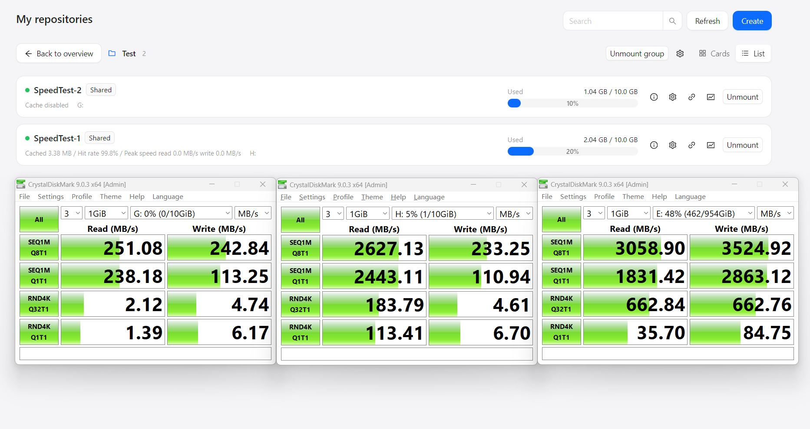
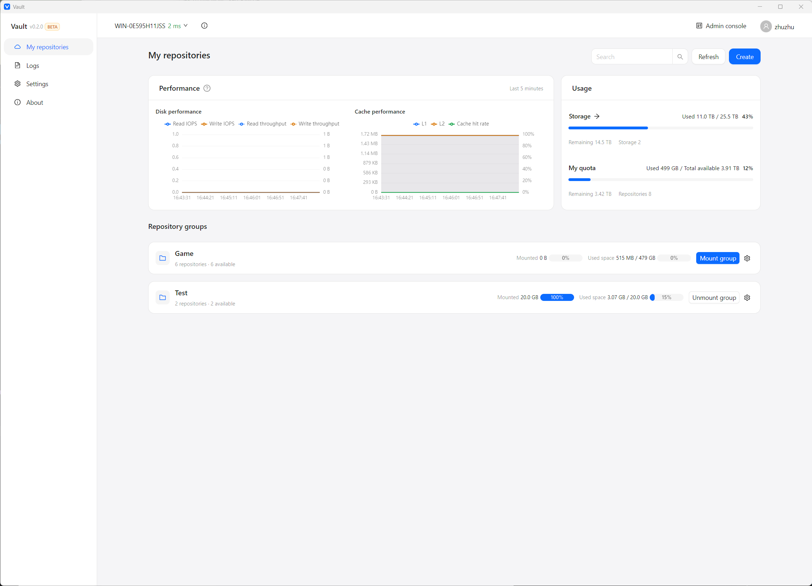
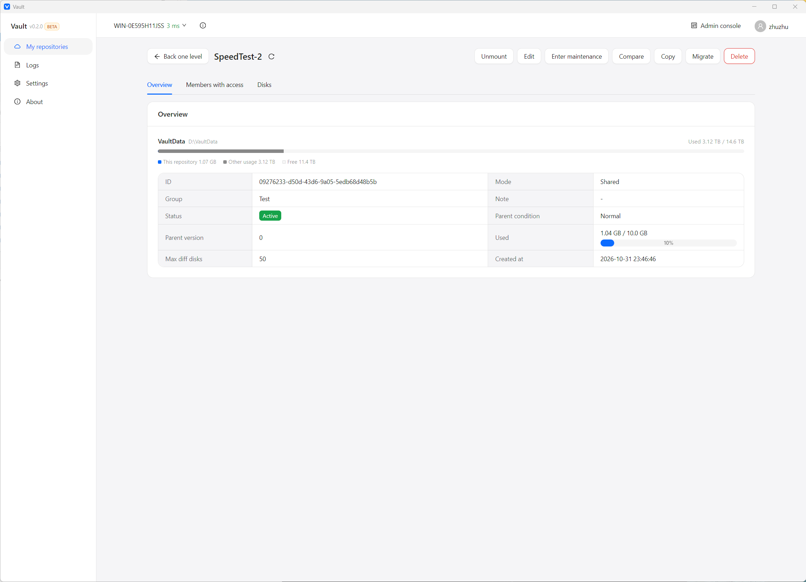
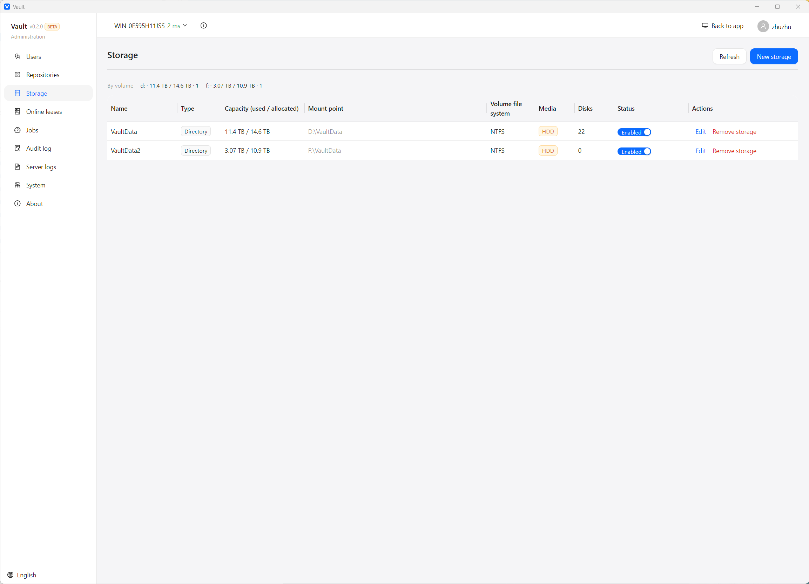

<div align="center">

[English](README.md) | **简体中文**

# Vault

**一份软件，多人共享。利用本地 SSD 加速 iSCSI，优化多读场景。**

自托管的虚拟磁盘与 iSCSI 存储平台：母盘 + 差异盘共享、客户端一键挂载、旁路读缓存加速。

[](https://go.dev)


[性能](#性能) · [基准](#基准) · [快速开始](#快速开始) · [核心能力](#核心能力) · [iSCSI 旁路加速](#iscsi-旁路加速) · [架构](#架构) · [文档](#文档)

</div>

Vault 把虚拟磁盘、iSCSI 目标、用户授权、租约、配额和客户端挂载收进一个应用。共享模式下只保留一份母盘，多个用户各自拿到独立差异盘；客户端在本机加一层透明的 iSCSI 读缓存，把远端 HDD 上的热数据放到内存和 SSD。

它适合这些场景：

- 同一套软件或游戏要装在很多台机器上，不想每台都复制一份完整磁盘。
- 想集中管理磁盘、iSCSI、账号和挂载，而不是分别操作 VHDX、Windows iSCSI Target、CHAP 和客户端脚本。
- 服务端只有 HDD，iSCSI 的随机读又慢又受网络影响，希望热数据读起来像本地盘。

## 性能

在 10 GiB 的 Vault 测试库上运行 CrystalDiskMark 9.0.3，从左到右依次为：**无缓存**（iSCSI 直连）、**有缓存**、**本地 SSD 盘（缓存盘）**，作为参照。测试大小 1 GiB，3 轮，单位 MB/s。



| 测试项 | 无缓存 | 有缓存 | 本地 SSD（缓存盘） |
| --- | ---: | ---: | ---: |
| SEQ1M Q8T1 读 | 251.08 | **2627.13** | 3058.90 |
| SEQ1M Q1T1 读 | 238.18 | **2443.11** | 1831.42 |
| RND4K Q32T1 读 | 2.12 | **183.79** | 662.84 |
| RND4K Q1T1 读 | 1.39 | **113.41** | 35.70 |
| SEQ1M Q8T1 写 | 242.84 | 233.25 | 3524.92 |
| SEQ1M Q1T1 写 | 113.25 | 110.94 | 2863.12 |
| RND4K Q32T1 写 | 4.74 | 4.61 | 662.76 |
| RND4K Q1T1 写 | 6.17 | 6.70 | 84.75 |

- 顺序读约为直连的 10 倍，达到本地 SSD 的 86%。
- 4K 随机读提升约 80-90 倍；其中 `Q1T1` 的缓存结果甚至快于本地 SSD，因为它由 L1 内存直接返回。
- 写入与无缓存时基本持平：写命令不经过缓存，始终直达后端。
- 本次测试客户端记录的**读命中率为 99.8%**。首次读、冷数据和一次性大顺序扫描不会被加速。

命中后如何完全绕过网络，见 [iSCSI 旁路加速](#iscsi-旁路加速)。

## 基准

实际发布的 v2 代理和读缓存都带可复现的 Go benchmark，不接真实后端也能对比改动。完整方法和 1 ms / loopback 两组原始输出见 [docs/benchmark.md](docs/benchmark.md)。

参考环境：Windows 11、Ryzen 9 9900X、Go 1.27.1，进程内假后端 + loopback。下面是单次 `-count=1` 的原始输出；数字会飘几百分点，回归对比请用 `-count=5` + `benchstat`。

缓存路径：

```text
goos: windows
goarch: amd64
pkg: vault/internal/iscsicache/cache
cpu: AMD Ryzen 9 9900X 12-Core Processor
BenchmarkReadCachedL1/4KiB-24 	31011678	        37.55 ns/op	109081.40 MB/s	       0 B/op	       0 allocs/op
BenchmarkReadCachedL1/64KiB-24         	 2176653	       549.8 ns/op	119207.36 MB/s	       0 B/op	       0 allocs/op
BenchmarkReadCachedL1/1MiB-24          	   84010	     14315 ns/op	73247.66 MB/s	       0 B/op	       0 allocs/op
BenchmarkReadCachedBoth-24             	   29432	     40736 ns/op	25740.47 MB/s	   11979 B/op	      53 allocs/op
BenchmarkStats-24                      	  603427	      2051 ns/op	       0 B/op	       0 allocs/op
BenchmarkInstall-24                    	  353917	      3390 ns/op	19331.06 MB/s	   65584 B/op	       2 allocs/op
PASS
ok  	vault/internal/iscsicache/cache	25.428s
```

代理，HDD 形态（假后端加 10 ms 服务时间）：

```text
goos: windows
goarch: amd64
pkg: vault/internal/iscsiproxy
cpu: AMD Ryzen 9 9900X 12-Core Processor
BenchmarkProxyReadHDD/direct/4KiB-24         	     100	  10485547 ns/op	   0.39 MB/s	         1.000 backend-reads/op	    4525 B/op	      11 allocs/op
BenchmarkProxyReadHDD/proxy-passthrough/4KiB-24         	     100	  10480889 ns/op	   0.39 MB/s	         1.000 backend-reads/op	    7232 B/op	      11 allocs/op
BenchmarkProxyReadHDD/proxy-hot/4KiB-24                 	   49376	     24293 ns/op	 168.61 MB/s	         0 backend-reads/op	     486 B/op	       8 allocs/op
BenchmarkProxyReadHDD/direct/64KiB-24                   	     100	  10425120 ns/op	   6.29 MB/s	         1.000 backend-reads/op	   66110 B/op	      11 allocs/op
BenchmarkProxyReadHDD/proxy-passthrough/64KiB-24        	     100	  10534212 ns/op	   6.22 MB/s	         1.000 backend-reads/op	   69631 B/op	      14 allocs/op
BenchmarkProxyReadHDD/proxy-hot/64KiB-24                	   30282	     38465 ns/op	1703.78 MB/s	         0 backend-reads/op	     767 B/op	      13 allocs/op
BenchmarkProxyReadHDD/direct/1MiB-24                    	     100	  10788780 ns/op	  97.19 MB/s	         1.000 backend-reads/op	 1051425 B/op	      15 allocs/op
BenchmarkProxyReadHDD/proxy-passthrough/1MiB-24         	      87	  11939868 ns/op	  87.82 MB/s	         1.000 backend-reads/op	 1066138 B/op	      17 allocs/op
BenchmarkProxyReadHDD/proxy-hot/1MiB-24                 	    3812	    339005 ns/op	3093.10 MB/s	         0 backend-reads/op	   19687 B/op	     133 allocs/op
PASS
ok  	vault/internal/iscsiproxy	11.909s
```

怎么读：L1 命中是几十纳秒且零分配，1 MiB L1 命中约 14 µs；代理命中 4 KiB 约 24 µs、1 MiB 约 0.34 ms，后端读数为 **0**。HDD 形态下 4K/64K 未命中与直连持平，1 MiB 未命中约为直连的 90%，差的是固定本地拷贝。`BenchmarkReadCachedBoth` 那一行是内存假 L2 的提升开销，真实 SSD 的读延迟要另外加。

这些是包级下限，不是端到端承诺；真实挂载盘的结果见 [性能](#性能)。

## 核心能力

- **共享存储库**：一份母盘作为基线，每个用户分配一块差异盘。软件只装一次，每人只写自己的改动。
- **从目录到可挂载盘**：支持从服务端目录、客户端本地目录创建，分块上传可断点续传，上传后可以逐文件核对。
- **一个客户端完成管理和使用**：普通用户看到自己的存储库和挂载，超级管理员在同一个应用里管理用户、存储、任务、审计和服务端配置；支持多服务端与自动更新。
- **HDD iSCSI 旁路加速**：未命中时保持接近直连的速度，命中后直接读本机内存或 SSD，不再走网络和 HDD。
- **服务端 SSD 缓存**：Linux 上可以把 SSD 作为 LVM thin pool 的 `dm-cache`，在块层加速 HDD。
- **可控的在线状态**：以客户端租约心跳为准，支持撤销租约和强制下线；证书登录、审计和自动更新一并提供。

## 界面

客户端就是完整的产品：普通用户看到自己的存储库和挂载，超级管理员在同一个应用里多一个服务端管理台。

**我的存储库** — 近 5 分钟的读写 IOPS、吞吐、L1/L2 缓存占用和命中率，以及配额和存储库分组。



**存储库详情** — 相对母盘的使用量、模式、母盘版本与状态、差异盘、成员，以及维护操作。



**管理台** — 存储卷、容量、介质类型、磁盘数量和启用状态；用户、存储库、租约、任务和审计都在同一个管理台里。



## iSCSI 旁路加速

这是 Vault 最核心的设计。

大多数“带缓存的 iSCSI 代理”会自己实现 Target 接住发起端，再自己实现 Initiator 连后端，所有流量都经过自研的会话状态机。缓存能生效，但登录协商、命令窗口、Data-In 分段、R2T 和序号记账中的任何一环出问题，整条链都会变慢。

Vault 不终止会话。发起端仍然和后端目标做完整的登录、CHAP 和参数协商，代理只在 TCP 连接旁边观察和转发：

```text
Windows 应用 / 资源管理器
        │
        │ iSCSI，连接 127.0.0.1:<随机端口>
        ▼
Vault-Agent 本地缓存代理
        │
        │ iSCSI，连接服务端真实目标（真实 IQN，CHAP 端到端）
        ▼
Vault-Server → LIO / Windows iSCSI Target → thin LV / VHDX → HDD
```

### 数据怎么走

| 场景 | 代理做什么 | 用户得到什么 |
| --- | --- | --- |
| 登录 / 协商 / 写 / 未命中读 | 原样转发字节流 | 性能接近直连，CHAP 端到端完成 |
| 读完整命中 L1 或 L2 | 吞掉命令，本地生成 Data-In 代答 | 不走网络，也不读 HDD |
| 读部分命中 | 整条命令转发，顺带回填缓存 | 不拆分协议，下一次才可能整条命中 |
| 协商出 digest / 多连接 / ERL>0 | 该会话永久降级为纯字节透传 | 缓存不生效，但连接和挂载正常 |

转发不是“一帧一次系统调用”：连续到达的 PDU 会攒进批缓冲，只读缓冲里没有下一个字节时一次写出，因此不会为了凑批而等待；大帧走 gather 写。代理只在旁路读取少量头字段，不重建 PDU。

命中代答的核心是序号修正。代理本地答了一条后端从未见过的命令，两端对 CmdSN / StatSN 的计数会错位，因此代理维护“本地代答次数”偏移量：

- 后端 → 发起端：`StatSN`、`ExpCmdSN`、`MaxCmdSN` 加上偏移量；
- 发起端 → 后端：`CmdSN`、`ExpStatSN` 减去偏移量；
- 登录阶段偏移量为 0，登录 PDU 完全不动。

这不是重排，也不是缓存响应：被代答的命令根本没有发给后端，后端不会产生需要拦截的响应。

### 为什么能快

**读未命中时**，命令照常发给后端，代理只旁路观察返回的 Data-In，按 `BufOffset` 把数据收进收集缓冲，完成后异步交给缓存。读命令不会为了缓存而等待，也不会产生第二次后端读。

**读命中时**，数据来自两级缓存：

| 层级 | 位置 | 作用 |
| --- | --- | --- |
| L1 | 客户端内存 | 最热的数据，直接从内存返回 |
| L2 | 客户端本地 SSD / NVMe 文件 | 温热数据，命中后从本地盘返回，并提升到 L1 |

L1 使用 64 KiB 块、4 KiB 扇区，按扇区记录有效位，淘汰使用 S3-FIFO，避免一次性顺序扫描冲掉热区。L2 是固定大小的本地缓存文件，索引跨重启保留；L1 在正常停止或卸载时写快照，下次启动可以装回内存。

### 面向 HDD 的 L2 布局

如果 L2 按到达顺序分配槽位，缓存用久了会把同一个 1 MiB 读拆成很多互不相关的 64 KiB 本地读，热区数据也会被写到文件各处，最后本地 SSD 也在做随机 IO。

Vault 的 L2 采用**区域归位布局**：把 LBA 空间按区域划分，同一区域内的相邻块在缓存文件里也物理相邻。

```text
LBA 区域 R（默认 128 个块，8 MiB）
  块 i 的物理位置 = 该区域的固定起点 + i
```

命中一段连续的 LBA，就是一段连续的物理字节，一次读可以合并成一个大传输，默认上限 1 MiB；同一区域被反复访问时位置保持稳定，不会因为环形分配被不断打散。代价是区域内的空槽不能挪给别的区域，热区只占区域一小部分时会浪费一些容量。

配合顺序扫描准入：连续的大顺序流只透传、不填充，避免全盘扫描冲掉真正的热区。扫描本身的带宽仍然走直连。

### 写路径与一致性

Vault 的读缓存不接收写数据。写命令的规则是：

```text
写命令 → 解析覆盖范围 → 失效对应缓存 → 原样转发后端 → 返回结果
```

- L1 的失效是同步的，保证“写完立刻读”不会读到旧值。
- L2 的失效放到后台，读路径用门控拦住尚未完成失效的旧扇区，不拖慢每一次写。
- 不存在脏块，不存在 writeback，不存在“掉电后还有没写回的数据”。
- 无法解析范围的命令会让缓存整盘失效一次，宁可冷掉，也不返回旧数据。
- 缓存命名空间绑定后端 IQN、VPD 序列号/WWID、容量和逻辑块大小，换盘后的旧缓存不会被装回来。
- L2 先写数据再写提交记录，记录带 CRC；崩溃后先验证，验证不通过就当未命中。

### 配额与降级

缓存预算是这台客户端所有库共享的总上限，默认 L1 = 512 MiB、L2 = 4 GiB，按库容量占比分摊。每个库默认开启缓存，可以单独关闭；L2 设为 0 表示只保留内存缓存。

客户端展示当前占用、配额、读命中率、读写 IOPS、峰值吞吐和近 5 分钟曲线。清空缓存不需要卸载或重登。

代理注册失败（端口占用、配额不足等）时回退直连；如果本机门户已经启用但后端连不上，挂载会显示连接阶段错误和后端门户可达性诊断，不会把缓存故障伪装成挂载成功。

### 与服务端 dm-cache 的关系

Linux 服务端可以把 SSD 作为 LVM thin pool 的 `dm-cache`，在块层缓存 HDD 数据。它和客户端旁路缓存解决的是两段不同的问题：

- 服务端 `dm-cache`：减少 HDD 读，但数据仍要经过网络。
- 客户端旁路缓存：命中后连网络都不用走，按每台机器的热区独立生效。

两者可以同时使用。Windows 服务端没有等价的 `dm-cache` 能力，HDD 加速主要依靠客户端旁路缓存。

## 共享存储库

Vault 对用户暴露的概念不是 VHDX 或 iSCSI target，而是存储库：

```text
存储库 = 母盘/独享盘 + 差异盘 + iSCSI 目标 + 分配 + 鉴权 + 配额 + 客户端挂载参数
```

| 模式 | 结构 | 适合 |
| --- | --- | --- |
| 共享库 | 一份母盘 + 多块差异盘，每个用户一块 | 同一套软件/游戏给多人使用 |
| 独享库 | 单块磁盘 + 单 iSCSI 目标 | 一个人独占一块盘 |

共享库在建库时可以预创建差异盘池和对应的 iSCSI 目标，分配时直接占用，不需要现场建盘。用户读到的是“母盘 + 自己的差异盘”的合并视图，写入只落在自己的差异盘。释放时，池化库会把差异盘重置回池，下一位用户拿到干净盘。

更新母盘时进入维护态：禁止新的分配和挂载，清理旧版本差异盘，更新母盘内容。退出维护会递增母盘版本，之后分配按新版本生成差异盘。维护态的母盘文件管理在服务端完成，不需要把母盘挂到客户端。

## 使用流程

1. **建库**：选择空盘、服务端目录，或从客户端本地目录上传；共享库设置共享数量。
2. **分配**：选择用户，系统分配差异盘和独立的 iSCSI 目标，并下发挂载参数。
3. **挂载**：客户端登录后选择盘符或目录，自动完成 iSCSI 连接和磁盘上线。
4. **日常使用**：支持自动挂载、分组配置、挂载后脚本；需要更新母盘时进入维护态。

## 架构

```text
┌──────────────────────── Windows 客户端 ────────────────────────┐
│  Electron 界面（用户视图 / 管理视图）                          │
│                                                                │
│  Vault-Agent                                                   │
│    ├─ 挂载、卸载、租约心跳、自动挂载、自动更新                 │
│    └─ iSCSI 旁路读缓存（仅监听 127.0.0.1）                     │
│         ├─ 默认：TCP 字节透传                                  │
│         ├─ 读全命中：本地生成 Data-In 代答                     │
│         └─ 读未命中：透传 + 旁路回填                           │
└───────────────┬───────────────────────────┬────────────────────┘
                │ HTTPS + SSE（控制面）      │ iSCSI（数据面）
┌───────────────▼───────────────────────────▼────────────────────┐
│ Vault-Server                                                   │
│   存储库 / 分配 / 租约 / 任务 / 用户 / 证书 / 审计             │
│                                                                │
│   平台后端（由构建产物选择）                                    │
│     Windows：VHDX + Windows iSCSI Target                       │
│     Linux  ：LVM thin LV + LIO                                 │
│                                                                │
│   数据盘：HDD（Linux 可选 SSD 作为 dm-cache）                   │
└────────────────────────────────────────────────────────────────┘
```

### 平台支持

| | Windows | Linux |
| --- | --- | --- |
| 服务端虚拟磁盘 | VHDX（VirtDisk API） | LVM thin LV |
| 差异盘 | VHDX 差异盘 | thin 快照 |
| iSCSI 目标 | Windows iSCSI Target | LIO（configfs + targetcli） |
| 会话枚举 / 强制登出 | 不支持，以客户端租约为准 | LIO 支持，作为交叉校验 |
| 服务端 SSD 缓存 | — | dm-cache |
| 客户端 | Windows 10/11 | 尚未实现 |

## 快速开始

### 依赖

- Go 1.25+
- Node.js 20+、pnpm
- Python 3.10+
- 客户端：Windows 10/11，启用 Microsoft iSCSI Initiator

### 构建

```bash
python build.py                 # 前端 + 服务端 + 客户端
python build.py --skip-frontend # 只构建 Go 二进制
python build.py --package-all   # Windows / Linux 服务端包 + 客户端安装包
```

构建产物在 `dist/`。

### 启动服务端

Windows Server 需要安装并启动 **iSCSI Target Server** 角色（`FS-iSCSITarget-Server`）。

```bash
cp config.example.yaml config.yaml
```

最小配置示例：

```yaml
http:
  listen: "0.0.0.0:8443"
  tls:
    enabled: true

storage:
  whitelist_root: "D:\\VaultData"

platform:
  kind: "auto"
```

路径按当前平台填写：Windows 使用 `D:\VaultData`，Linux 使用 `/var/lib/vault` 这类绝对路径。

```bash
# Windows
Vault-Server.exe -config .\config.yaml

# Linux
./vault-server -config ./config.yaml
```

Linux 首次部署先准备 LVM2、`targetcli`、LIO 内核模块和 `configfs`：

```bash
sudo ./scripts/setup.sh
./vault-server doctor
```

### 连接客户端

安装构建出的客户端，输入服务端地址，核对 TLS 指纹并登录。服务端还没有超级管理员时，客户端会引导完成初始化；之后即可创建存储库、分配用户并挂载。

服务端只提供 REST API 和 SSE，不提供网页管理入口，管理和使用都在客户端完成。

## 开发

```bash
# iSCSI 代理与缓存
go test ./internal/iscsiproxy/...
go test ./internal/iscsicache/...

# 前端
cd frontend
pnpm install
pnpm typecheck
pnpm build
```

<details>
<summary>项目结构</summary>

```text
cmd/
  vault-server/            服务端入口
  vault-agent/             客户端本地代理入口（含缓存代理）
  vault-iscsi-cache/       独立的缓存代理验证入口

internal/
  iscsiproxy/              iSCSI 旁路透传、命中代答、序号改写、tee 回填
  iscsicache/
    cache/                 L1/L2 读缓存、S3-FIFO、失效、L1 快照
    l2/                    L2 文件布局、stamp、索引、区域归位
    identity/              后端盘身份命名空间
    iscsi/                 PDU / SCSI 编解码
  platform/
    winvhd/ winps/         Windows VHDX 与 PowerShell 后端
    linuxlvm/              LVM thin / dm-cache
    liotarget/             LIO iSCSI 目标
  app/ api/ domain/ store/ 业务服务、HTTP API、领域模型、数据库
  agent/                   客户端挂载、租约、自动更新、缓存管理

frontend/
  apps/client/             Electron 客户端
  packages/ui/             用户界面与管理界面共用组件
```

</details>

## 发布

对外版本号存放在 [`RELEASE.json`](RELEASE.json)（`version` + `channel`）；`VERSION` 里的内部构建号仍然负责自动更新和兼容性判定。客户端侧边栏展示对外版本和渠道标签，内部构建号在「关于」里展示。

```bash
python release.py                        # 构建并整理到 release/v0.1.0-beta/
python release.py --version 0.2.0 --channel beta
python release.py --skip-build           # 只整理 dist/package 里已有的产物
python release.py --with-linux           # 额外收集 Linux 服务端 tar.gz
```

输出目录里有两个 zip、`SHA256SUMS.txt` 和可直接编辑的 `RELEASE_NOTES.md`。可以手动把两个 zip 上传到 GitHub Release，也可以执行脚本最后打印的 `gh release create` 命令。脚本本身不会自动发布。

正式发布要求签名私钥已经存在（`keys/update-private.pem` + `keys/update-public.txt`），或用 `--key` 指定；除非显式加 `--allow-keygen`，脚本不会临时生成新密钥。

## 文档

| 文档 | 内容 |
| --- | --- |
| [产品设计](docs/design.md) | 目标、角色、存储库与客户端设计 |
| [实施文档](docs/implementation.md) | 架构、数据模型、平台实现与边界 |
| [Benchmark](docs/benchmark.md) | 代理与缓存的基准方法、命令与参考结果 |
| [客户端代理 API](docs/agent-api.md) | 本地挂载、缓存、状态与事件接口 |
| [iSCSI 缓存设计](docs/iscsi-cache/iscsi_cache_v2_design.md) | 旁路代理、序号修正、故障降级 |
| [L2 区域归位布局](docs/iscsi-cache/l2_region_layout_design.md) | 把 L2 命中变成顺序读 |
| [Windows iSCSI/VHDX 边界](docs/windows-iscsi-vhdx-api.md) | Windows 平台能力与限制 |

## 当前边界

- 客户端目前只提供 Windows 版本；Linux 服务端已支持，Linux 客户端尚未实现。
- 缓存只加速读；写始终直达后端，不提供 writeback。
- 首次读、冷数据、一次性大顺序扫描不会被加速。
- 一个分配按单客户端挂载设计；多客户端同时写同一 LUN 不在缓存一致性保证范围内。
- 缓存不可用时优先回退直连；如果已经选中本机门户但后端连不上，会按连接错误显示，并给出后端门户的可达性诊断。

## 许可证

本项目采用 [PolyForm Noncommercial License 1.0.0](LICENSE)：个人学习、研究、实验，以及慈善、教育、公共研究、公共安全/健康、环保和政府机构等非商业用途可以免费使用。

**任何商业用途都需要单独的商业授权**，包括但不限于商业产品集成、企业内部商业运营、对外提供付费或带商业目的的服务。商业授权请联系项目维护者：[github.com/junqirao/vault](https://github.com/junqirao/vault)。

